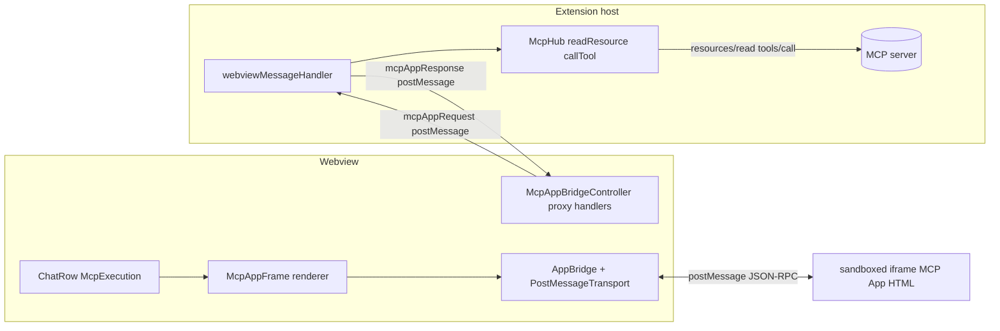
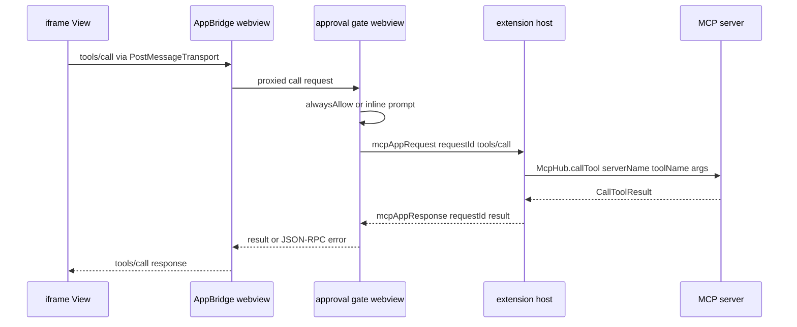

# MCP Apps UI support architecture

Status: reviewed architecture (validated against the codebase on 2026-10-07). This document is the input for a later implementation-planning task; it is not itself an implementation plan and contains no code changes.

## Scope and standard summary

MCP Apps is the official MCP extension for attaching interactive HTML UIs to MCP tools (standardized from the MCP-UI project; see [MCP-UI introduction](https://mcpui.dev/guide/introduction) and modelcontextprotocol/modelcontextprotocol PR #1865). The core pattern:

1. A tool definition carries `_meta.ui.resourceUri` pointing at a `ui://...` resource. Legacy MCP-UI servers used the flat key `_meta["ui/resourceUri"]`.
2. The host fetches the UI HTML via `resources/read`. The standard MIME type is `text/html;profile=mcp-app`.
3. The host renders the HTML in a sandboxed iframe and runs two-way JSON-RPC over postMessage (the "app bridge"): `ui/initialize` handshake, then `ui/message`, `ui/open-link`, `ui/update-model-context`, proxied `tools/call`, and notifications such as `ui/notifications/size-changed` and `ui/notifications/sandbox-proxy-ready`.

Text content in tool results always remains and is what the model sees; the UI renders alongside it. Reference SDKs: `@mcp-ui/client` (React `AppRenderer`/`AppFrame`), `@mcp-ui/server` (`createUIResource`), and `@modelcontextprotocol/ext-apps` (`registerAppTool`/`registerAppResource`, host-side `AppBridge` + `PostMessageTransport`).

## Verified current state

Every preliminary finding was checked against the actual files. Verdicts:

| #   | Claim                                                                                              | Verdict   | Evidence / correction                                                                                                                                                                                                                                                                                                                                                                                                                                                                 |
| --- | -------------------------------------------------------------------------------------------------- | --------- | ------------------------------------------------------------------------------------------------------------------------------------------------------------------------------------------------------------------------------------------------------------------------------------------------------------------------------------------------------------------------------------------------------------------------------------------------------------------------------------- |
| 1   | `src/package.json:482` pins `@modelcontextprotocol/sdk` at 1.29.0                                  | **Holds** | Exact pin `"@modelcontextprotocol/sdk": "1.29.0"` at [`src/package.json`](../../src/package.json:482). Installed copy resolves under `src/node_modules/@modelcontextprotocol/sdk` (workspace-hoisted per-package, not root).                                                                                                                                                                                                                                                          |
| 2   | `fetchToolsList()` spreads raw tool objects so `_meta` flows through; `McpTool` type lacks `_meta` | **Holds** | [`fetchToolsList`](../../src/services/mcp/McpHub.ts:1448) maps `(response?.tools \|\| []).map((tool) => ({ ...tool, alwaysAllow, enabledForPrompt }))` (lines 1495–1499). [`McpTool`](../../packages/types/src/mcp.ts:70) declares only `name`, `description`, `inputSchema`, `alwaysAllow`, `enabledForPrompt`. So `_meta` is present at runtime but invisible to TypeScript and stripped by nothing — it already reaches the webview through `ExtensionState.mcpServers`.           |
| 3   | `readResource()` ~2194 and `callTool()` ~2213 exist; per-tool approval config exists               | **Holds** | [`readResource`](../../src/services/mcp/McpHub.ts:2194) (throws on disconnected/disabled server), [`callTool`](../../src/services/mcp/McpHub.ts:2213) (per-server timeout, OAuth re-auth retry). `alwaysAllow`/`disabledTools` are parsed from mcp.json in `fetchToolsList` (lines 1483–1498) and defined in [`ServerConfigSchema`](../../src/services/mcp/McpHub.ts:74).                                                                                                             |
| 4   | `McpToolCallResponse` already includes `_meta`                                                     | **Holds** | [`packages/types/src/mcp.ts:120-121`](../../packages/types/src/mcp.ts:120).                                                                                                                                                                                                                                                                                                                                                                                                           |
| 5   | Webview renders MCP tool results as text/JSON only                                                 | **Holds** | [`ChatRow.tsx:1666-1668`](../../webview-ui/src/components/chat/ChatRow.tsx:1666) renders `<McpExecution executionId={message.ts.toString()} …>` for `use_mcp_tool`; [`McpExecution.tsx`](../../webview-ui/src/components/chat/McpExecution.tsx:236) renders arguments/response via `CodeBlock`/`Markdown` and listens for `mcpExecutionStatus` ExtensionMessages filtered by `executionId` (lines 134–164).                                                                           |
| 6   | MCP webview messages are handled in `webviewMessageHandler.ts`                                     | **Holds** | Existing types: `openMcpSettings`, `openProjectMcpSettings`, `deleteMcpServer`, `restartMcpServer`, `toggleToolAlwaysAllow`, `toggleToolEnabledForPrompt`, `toggleMcpServer`, `updateMcpTimeout`, `refreshAllMcpServers` ([lines 1717–1839](../../src/core/webview/webviewMessageHandler.ts:1751)). Also relevant: a generic [`openExternal`](../../src/core/webview/webviewMessageHandler.ts:1566) handler already calls `vscode.env.openExternal` (no URL-scheme validation today). |

Corrections / additions to the preliminary findings:

- **The webview CSP is not in `webview-ui/index.html`.** That file has no CSP meta tag at all. The real CSP is injected by [`ClineProvider.getDevHtmlContent`](../../src/core/webview/ClineProvider.ts:1593) (dev, Vite-served) and [`ClineProvider.getHtmlContent`](../../src/core/webview/ClineProvider.ts:1688) (production). Both start with `default-src 'none'` and **neither declares `frame-src`**, so today no iframe of any kind can load — including `srcdoc`.
- The tool-result approval flow is task-scoped: [`UseMcpToolTool`](../../src/core/tools/UseMcpToolTool.ts:123) calls `task.ask("use_mcp_server", …)`; auto-approval resolves via [`isMcpToolAlwaysAllowed`](../../src/core/auto-approval/mcp.ts:3) plus the global `alwaysAllowMcp` setting. Results stream to the webview as `mcpExecutionStatus` messages ([UseMcpToolTool.ts:289-293](../../src/core/tools/UseMcpToolTool.ts:289)).
- The SDK 1.29.0 `ClientCapabilitiesSchema` **does** include an open-ended `extensions?: Record<string, object>` field ([types.d.ts:614](../../src/node_modules/@modelcontextprotocol/sdk/dist/esm/types.d.ts:614)), and the current [`new Client(...)` call passes `capabilities: {}`](../../src/services/mcp/McpHub.ts:718). Declaring a UI extension capability is therefore possible without any SDK change.
- There is an existing request/response correlation precedent on the message bus: `WebviewMessage.requestId` ([vscode-extension-host.ts:694](../../packages/types/src/vscode-extension-host.ts:694)) used by `searchFiles`/`searchCommits` and the `themeFixtureProbeRequest`/`themeFixtureProbeResponse` pair.

### External package facts (verified against the npm registry on 2026-10-07)

| Package                                 | Latest | Compatibility with this repo                                                                                                                                                                                                                                                                |
| --------------------------------------- | ------ | ------------------------------------------------------------------------------------------------------------------------------------------------------------------------------------------------------------------------------------------------------------------------------------------- |
| `@modelcontextprotocol/ext-apps`        | 2.0.3  | 2.x peers `@modelcontextprotocol/sdk ^2.0.0` — **incompatible** with our 1.29.0 pin. The **1.x line (latest 1.7.5)** peers `@modelcontextprotocol/sdk ^1.29.0`, `zod ^3.25 \|\| ^4`, `react ^17\|^18\|^19` — **compatible**. Subpath exports include `./app-bridge`, `./react`, `./server`. |
| `@mcp-ui/client`                        | 7.1.1  | Peers `react/react-dom ^18 \|\| ^19` (webview has 18.3.1 ✓). Depends on `@modelcontextprotocol/ext-apps ^1.2.0`, `@modelcontextprotocol/sdk ^1.27.1`, `zod ^3.23.8` as **regular dependencies** — pnpm may install a second SDK copy inside the webview bundle (see Risks).                 |
| `@modelcontextprotocol/sdk` (installed) | 1.29.0 | `LATEST_PROTOCOL_VERSION = "2025-11-25"`; `ClientCapabilities.extensions` present.                                                                                                                                                                                                          |

Key API facts from `@modelcontextprotocol/ext-apps@1.7.5` (`app-bridge.d.ts`):

- `getToolUiResourceUri(tool)` extracts the UI URI and **already supports both** `_meta.ui.resourceUri` (preferred) and deprecated `_meta["ui/resourceUri"]`.
- `new AppBridge(client: Client | null, hostInfo, capabilities: McpUiHostCapabilities, options?)` — when `client` is `null`, hosts register manual handlers (`oncalltool`, `onreadresource`, `onlistresources`, …) instead of automatic forwarding to a live MCP client. This is the exact seam our webview needs, because the real MCP `Client` lives in the extension host.
- Host capabilities include `openLinks`, `serverTools`, `logging`; events include `sizechange`, `sandboxready`, `initialized`.

## Architecture overview

Four cooperating layers; nothing about the model-facing tool pipeline changes (text results continue to flow through `use_mcp_tool` exactly as today).

### Flow 1: tool list → UI render

1. `fetchToolsList` already carries `_meta` into `McpServer.tools`, which is posted to the webview in `ExtensionState.mcpServers`. With the type change (Phase 1), ChatRow can look up `getToolUiResourceUri(tool)` for the row's `serverName`/`toolName`.
2. When a `use_mcp_tool` ChatRow renders and the tool declares a UI resource (and the feature flag is on, and the server has not opted out), `McpAppFrame` requests the HTML: webview → extension `mcpAppRequest { method: "resources/read", params: { uri } }` → existing [`readResource()`](../../src/services/mcp/McpHub.ts:2194) → response posted back with the matching `requestId`.
3. The fetched HTML (text or base64-decoded blob, MIME `text/html;profile=mcp-app`) is handed to the renderer, which loads the bundled sandbox-proxy document and starts the app-bridge handshake, then pushes the tool input/result into the view (`ui/notifications/tool-input`, `tool-result` per the spec notifications).

### Flow 2: UI-initiated proxied `tools/call`

### Flow 3: other app-bridge traffic

- `ui/open-link` → validated against a URL-scheme allowlist in the webview gate, then the existing [`openExternal`](../../src/core/webview/webviewMessageHandler.ts:1566) message.
- `ui/message` → v1 maps to the existing `insertTextIntoTextarea` webview message (user-visible, user-presses-send). No silent message injection.
- `ui/update-model-context` → **not advertised** in v1 (see Decision b); capability negotiation reports no support so spec-compliant views degrade to text.
- Size-change notifications → the frame component adjusts height (same pattern as `react-textarea-autosize` usage elsewhere).
- Theme: VS Code CSS variables are already available in the webview; the proxy document forwards them into the app via the bridge's host-styles mechanism (`useHostStyles` on the view side).

## Resolved design decisions

### a. iframe hosting — bundled sandbox-proxy document, not raw `srcdoc`

**Decision:** ship a small `mcp-app-sandbox-proxy.html` inside the extension bundle, load it as the outer iframe via `webview.asWebviewUri(...)` (a `vscode-webview://` URL covered by `${webview.cspSource}`), and let it create the inner `srcdoc` iframe that holds hostile app HTML. Add exactly one CSP directive — `frame-src ${webview.cspSource}` — to **both** the dev CSP ([ClineProvider.ts:1593](../../src/core/webview/ClineProvider.ts:1593)) and the production CSP ([ClineProvider.ts:1688](../../src/core/webview/ClineProvider.ts:1688)).

**Rationale:** a `srcdoc` iframe inherits the _embedding document's_ CSP. The webview's production `script-src` is nonce + `strict-dynamic` with no `'unsafe-inline'`, so arbitrary MCP-app HTML (which is full of inline `<script>` tags) would be dead on arrival inside a direct srcdoc frame — unless we weakened the top-level CSP, which we must not do. The proxy document is a separate document with its own meta-CSP that we control; its nested srcdoc frame inherits _that_ policy, giving apps normal script execution while the top-level webview CSP stays unchanged apart from `frame-src`. This is also exactly the hosting model `@mcp-ui/client` expects (`sandbox={{ url }}`), so no fork is needed. The outer iframe uses `sandbox="allow-scripts"` **without** `allow-same-origin` (opaque origin: no access to webview DOM, `vscode` API, or extension state).

Rejected alternatives: raw srcdoc in the webview (requires `'unsafe-inline'` — rejected); a local HTTP server for the proxy (the existing [`callbackServer`](../../src/services/mcp/utils/callbackServer.ts) shows we _can_, but it adds a listening socket and `connect-src`/`frame-src` http entries — unnecessary attack surface).

### b. Bridge shape — `AppBridge(null)` + manual handlers over a correlated message pair

**Decision:**

- New message pair on the existing bus: `WebviewMessage.type = "mcpAppRequest"` carrying `{ requestId, serverName, source, method, params }`; `ExtensionMessage.type = "mcpAppResponse"` carrying `{ requestId, ok, result?, error? }`. Reuse the existing [`requestId`](../../packages/types/src/vscode-extension-host.ts:694) field; follow the `searchFiles`/`themeFixtureProbe` precedent. Add a timeout (reuse the per-server MCP timeout semantics from [`callTool`](../../src/services/mcp/McpHub.ts:2229)) and reject on webview reload.
- **v1 proxied methods:** `resources/read` (UI HTML fetch, restricted to `ui://` URIs) and `tools/call`. Nothing else crosses the boundary; `initialize`, `ui/*`, and notifications stay entirely inside the webview between `AppBridge` and the iframe.
- In the webview, construct `new AppBridge(null, hostInfo, capabilities)` from `@modelcontextprotocol/ext-apps/app-bridge` and register manual handlers that serialize onto the message pair. Do **not** subclass the SDK `Client`: `AppBridge`'s null-client mode is the documented extension seam, and a fake `Client` would depend on `Protocol` internals.
- **Approval enforcement lives in the webview gate**, as defense-in-depth with the host: the gate consults per-tool `alwaysAllow` (already present on `McpServer.tools` in ExtensionState) and global `alwaysAllowMcp` via the same semantics as [`isMcpToolAlwaysAllowed`](../../src/core/auto-approval/mcp.ts:3); when not always-allowed it shows an inline confirm affordance on the app frame and returns a JSON-RPC error on deny. The extension host independently re-checks server-disabled state (already enforced by `callTool`/`readResource`) and refuses any method outside the allowlist. Rationale: UI-initiated calls are user-driven, not part of the model's tool loop, so they cannot reuse the task-scoped `task.ask("use_mcp_server")` flow; a webview-side gate keeps the UX inline and avoids inventing a second task-level approval channel.

### c. Capability negotiation — manual `extensions` declaration with ext-apps 1.x helpers

**Decision:** declare the UI extension capability manually in the existing [`new Client(...)` options](../../src/services/mcp/McpHub.ts:718): `capabilities: { extensions: { "io.modelcontextprotocol/ui": {} } }`, gated on the feature flag. Do **not** adopt `@modelcontextprotocol/ext-apps` 2.x or SDK v2 (peer-incompatible with the exact 1.29.0 pin). In the webview, depend on `@modelcontextprotocol/ext-apps@^1.7.5` (peers `sdk ^1.29.0` ✓) and optionally `@mcp-ui/client@^7` for `AppRenderer`; if the duplicate-SDK bundling risk (below) bites, drop to direct `AppBridge` usage with a thin frame component.

**Rationale:** SDK 1.29's `ClientCapabilitiesSchema.extensions` is an open record — the spec-sanctioned place for extension capabilities — so no SDK fork or version bump is required. Unknown extensions are ignored by servers, making this additive and safe. Note: capabilities are sent at `initialize`, so toggling the flag only affects newly established connections; document that (and optionally trigger `refreshAllConnections` on change, mirroring how [`mcpEnabled`](../../src/core/webview/webviewMessageHandler.ts:836) triggers `handleMcpEnabledChange`).

### d. Settings and security round trip — `mcpAppsEnabled`, default off

**Decision:** one global boolean setting plus a per-server opt-out, following the AGENTS.md "Persisted Setting Checklist" end to end:

| Step                  | Location                                                                                                                                                                                             |
| --------------------- | ---------------------------------------------------------------------------------------------------------------------------------------------------------------------------------------------------- |
| Schema                | `mcpAppsEnabled: z.boolean().optional()` in [`global-settings.ts`](../../packages/types/src/global-settings.ts:244) next to `mcpEnabled`; shared default constant `DEFAULT_MCP_APPS_ENABLED = false` |
| ExtensionState        | Add `"mcpAppsEnabled"` alongside [`mcpEnabled: boolean`](../../packages/types/src/vscode-extension-host.ts:361)                                                                                      |
| SettingsView          | Bind from local `cachedState` only; include in the `updateSettings` payload from `handleSubmit()`                                                                                                    |
| webviewMessageHandler | Generic path suffices (no normalization needed); optionally call `refreshAllConnections()` so capability declaration converges without a manual restart                                              |
| ClineProvider         | Add to `getState()` with the default; add to **both** destructuring and return of `getStateToPostToWebview()`                                                                                        |
| Runtime consumers     | `McpHub` (capability declaration at connect time), ChatRow/McpAppFrame (render gate)                                                                                                                 |
| Import/export         | Included in settings schema so it round-trips; nothing secret                                                                                                                                        |
| Tests                 | UI binding/save, persistence, `getStateToPostToWebview()` returns saved value; both `true` and unset cases                                                                                           |

**Default false** because this executes untrusted third-party HTML/JS — the flag must be opt-in until the sandbox has real-world soak time.

**Per-server opt-out:** add optional `disableUi: z.boolean().optional()` to [`ServerConfigSchema`](../../src/services/mcp/McpHub.ts:74) (all three server-type variants), surfaced in the MCP settings UI next to the existing tool toggles, and honored by both the render gate (webview) and the `mcpAppRequest` handler (host). This mirrors the proven `disabledTools` pattern rather than inventing a parallel store.

**Hostile-HTML posture:** sandbox without `allow-same-origin`; size cap on fetched `ui://` payloads (recommend 2 MB before decode, re-check after base64 decode); `resources/read` proxied to views restricted to the `ui://` scheme; URL-scheme allowlist (`https:`, `http:`, `mailto:`) enforced _before_ `openExternal` for UI-initiated links (the existing handler has no validation — do not route unvalidated app URLs through it); proxy-document CSP scoped as tightly as the spec's apps require in practice (scripts yes; top-level navigation no).

### e. Legacy MCP-UI `_meta["ui/resourceUri"]` — include in v1

**Decision:** support both keys from day one, with nested `_meta.ui.resourceUri` taking precedence.

**Rationale:** free if we use `getToolUiResourceUri` from ext-apps (it implements exactly this precedence); trivial to mirror if we inline the extractor. The legacy-key server population is large in the wild, and there is no security or complexity argument for excluding it.

## Security model summary

- **Trust boundary:** hostile MCP-server HTML executes only inside an opaque-origin sandbox iframe hosted by a proxy document; it has no DOM access to the webview, no `vscode` API, no extension state, and its network behavior is governed by the proxy CSP.
- **Message gate:** the webview↔host bridge accepts only `{ resources/read (ui:// only), tools/call }`, correlated by `requestId`, with timeouts; the host re-validates server connectivity/disabled state and per-server `disableUi`.
- **Human-in-the-loop:** UI-initiated tool calls require per-tool `alwaysAllow` or an explicit inline confirmation; global kill switch `mcpAppsEnabled` (default off) plus per-server `disableUi`.
- **Outbound links:** scheme allowlist before `vscode.env.openExternal`.
- **Residual, inherent to the standard:** sandboxed apps can still make arbitrary network requests subject to the proxy CSP (chart CDNs, API calls). This is accepted for v1 and is the main reason the feature ships opt-in.

## Phased task breakdown (for the planning task to expand)

1. **Types & capability.** Add `_meta` (typed `ui.resourceUri` plus index signature) to `McpTool`; add a small shared extractor helper (both meta keys); declare the `io.modelcontextprotocol/ui` extension capability in `McpHub`'s `Client` construction behind the setting; unit tests in `src` for extraction precedence and capability presence/absence.
2. **Settings round trip.** Implement `mcpAppsEnabled` + per-server `disableUi` across every row of the checklist table above, with focused Vitest coverage (UI binding, persistence, state round trip).
3. **Extension-host bridge handler.** `mcpAppRequest` case in `webviewMessageHandler.ts`: method allowlist, `ui://` restriction, size cap, `disableUi`/disabled-server checks, routing to `readResource()`/`callTool()`, timeout + `mcpAppResponse`; unit tests for every rejection path.
4. **Webview bridge & rendering.** Add `@modelcontextprotocol/ext-apps@^1.7.5` (+ evaluate `@mcp-ui/client@^7`) to webview-ui; bundle the sandbox-proxy HTML and wire its URI through the existing `window.*_URI` template pattern; add `frame-src ${webview.cspSource}` to both CSP variants; build `McpAppFrame` (fetch → render → size/theme handling) and mount it in ChatRow/McpExecution alongside the text result; component tests with a mocked message bus.
5. **Approval gate & link safety.** Inline confirm flow for non-`alwaysAllow` UI tool calls, scheme allowlist for `ui/open-link`, `ui/message` → textarea insertion; tests for deny path and scheme rejection.
6. **Tests & docs.** One smoke e2e in `apps/vscode-e2e` (flag on → fixture server with a `ui://` tool → frame renders); update MCP docs pages; run focused suites + `pnpm test`.

## Risks and open questions

- **Duplicate SDK copies:** `@mcp-ui/client` 7.x depends on the SDK directly (not as peer), so pnpm may nest a second copy in webview-ui. Mitigation: verify with `pnpm why @modelcontextprotocol/sdk` after install; use a pnpm override to pin both to 1.29.0, or drop `@mcp-ui/client` and use `AppBridge` directly. Decide during Phase 4 spike.
- **ext-apps version line:** 2.x is the moving target (SDK v2 peers). Pinning `^1.7.5` freezes us on a legacy line; plan a migration task when the repo adopts SDK v2.
- **CSP/nested-frame behavior needs a spike:** srcdoc inheritance semantics inside VS Code webviews should be proven with a throwaway fixture before Phase 4 builds on it. Fallback if nested frames misbehave: render app HTML into the proxy document itself (no inner frame) — weaker isolation, so re-review would be required.
- **`ui/update-model-context` deferred:** no host plumbing exists for arbitrary model-context injection; advertising no support is spec-compliant degradation. Revisit with a dedicated context-injection design.
- **Per-call UI overrides unverified:** whether MCP Apps allows a tool _result_ `_meta` to override the declared `ui://` resource was not verified against the spec text during this review; if it exists, Phase 1's extractor should read result `_meta` too (the type already carries it).
- **Capability toggle latency:** capabilities are negotiated at connect time; without a connection refresh on flag change, servers see stale capabilities until restart. Mitigation noted in Decision d.
- **Not verified:** exact `McpUiHostCapabilities` field set beyond what the `.d.ts` examples showed (`openLinks`, `serverTools`, `logging`), and whether `@mcp-ui/client`'s `AppRenderer` exposes hooks to intercept proxied `tools/call` for our approval gate (vs. requiring direct `AppBridge` composition). Both are Phase 4 spike items; the architecture works either way because the gate is specified at the bridge-handler layer.
